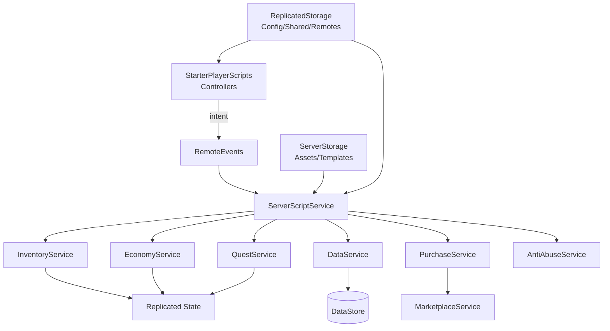
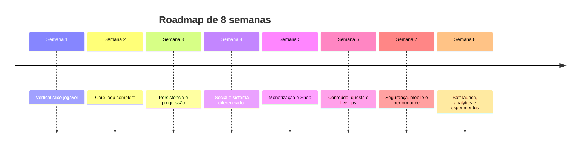

# Roblox em 2026: mercado, monetização, arquitetura e estratégia para criar um jogo original orientado a Robux

## Sumário executivo

Roblox chegou ao Q2 de 2026 com **123 milhões de DAUs, 29 bilhões de horas jogadas no trimestre e 27 milhões de pagantes mensais**, enquanto os dez maiores jogos caíram para cerca de 20% das horas da plataforma — sinal de maior diversificação e espaço para novos títulos. citeturn17search0turn17search2  
O segmento mais interessante economicamente é o americano de **18–34 anos**: cresceu mais de 50% YoY no Q1 e monetiza mais de 50% acima dos menores de 18 anos nos EUA; Roblox está incentivando explicitamente jogos mais profundos para esse público. citeturn17search1  
A oportunidade não é copiar um simulator: é combinar um loop extremamente legível de simulator/tycoon com **social, eventos, progressão persistente e uma camada diferenciadora** como horror, extração ou automação. Essa leitura é coerente com os atuais charts e com o algoritmo de discovery orientado a retenção de longo prazo. citeturn16search2turn16search5turn17search0  
Para monetização, o desenho mais saudável é uma escada formada por Developer Products repetíveis, Passes permanentes, cosméticos, bundles e eventualmente assinatura, usando preços dinâmicos e sem sacrificar retenção por monetização agressiva. citeturn14search1turn14search5turn25search1  
Para o projeto que você já começou, minha recomendação de melhor relação **risco × velocidade × potencial comercial** é transformar o “Potato Factory Simulator” em **Anomaly Harvest Co.**, um híbrido de fazenda/fábrica cooperativa com plantas estranhas, automação e eventos noturnos.

## Mercado Roblox e público internacional

### O tamanho da oportunidade mudou

O erro seria tratar Roblox em 2026 como “plataforma infantil de obby”. A plataforma está deliberadamente ampliando tanto a profundidade dos jogos quanto a idade do público.

No Q2 de 2026, Roblox reportou média de **123 milhões de usuários ativos diários**, crescimento de 10% YoY; **29 bilhões de horas de engajamento**, +5%; **27 milhões de monthly unique payers**, +15%; e US$ 1,5 bilhão de receita trimestral. Mais importante para um novo estúdio: os dez maiores jogos representaram aproximadamente **20% das horas**, contra 30% três anos antes. Em outras palavras, o oceano continua cheio de tubarões, mas já não existe apenas uma dúzia deles comendo tudo. citeturn17search0turn17search2

O sinal externo confirma o tamanho do funil mobile. A Sensor Tower colocou Roblox como o **jogo mobile mais baixado globalmente em setembro de 2026**, e também entre os cinco maiores em receita mobile naquele mês. Sua página de inteligência de App Store lista EUA, Reino Unido e Brasil entre as principais regiões e estima, para o mês anterior ao crawl, cerca de 5 milhões de downloads e US$ 57 milhões de receita — números da Sensor Tower, portanto estimativas de mercado mobile, não receita corporativa consolidada da Roblox. citeturn16search0turn16search6

### A mudança mais importante: jogadores mais velhos

Roblox revelou em abril de 2026 que a coorte **18–34 anos nos EUA estava crescendo mais de 50% YoY** e monetizava mais de 50% acima dos usuários americanos menores de 18 anos. A empresa passou inclusive a oferecer uma taxa DevEx 42% superior para determinados gastos feitos por usuários americanos 18+ verificados em jogos elegíveis dentro de sua iniciativa para “novel games”. Esses números usam dados de idade verificada e estimativas extrapoladas, portanto devem ser interpretados com a ressalva metodológica indicada pela própria Roblox. citeturn17search1turn17search3

Isso altera a estratégia.

Para um jogo em inglês, eu trataria:

**EUA 16–34 como mercado primário**, com monetização especialmente pensada para 18–34; **Reino Unido como segundo mercado natural**, aproveitando a mesma base textual em inglês; e demais países anglófonos como expansão orgânica. Sensor Tower já coloca EUA e Reino Unido entre as principais regiões do aplicativo. citeturn16search6

Não significa fazer um jogo “adulto”. Significa fazer algo que uma pessoa de 21 anos não abandone em dez segundos porque parece ter sido criado exclusivamente para uma criança de oito.

### O que está popular agora

O snapshot atual dos charts oficiais é extremamente diversificado. Entre os títulos de maior atividade aparecem **Murder Mystery 2, Steal An Egg, Brookhaven RP, Steal a Brainrot, 99 Nights in the Forest, Adopt Me!, RIVALS, Blox Fruits, Dress To Impress, Dandy's World, Pet Simulator 99!, DOORS e Tower of Hell**. Os charts de tendências também exibem uma quantidade impressionante de jogos baseados em conceitos instantaneamente compreensíveis: “Chop A Forest”, “Fix My Phone!”, “Make Rugs!”, “Clean all the Leaves”, “Build a PC” e “Run an Airline”. citeturn16search2turn16search5

Isso sugere duas forças simultâneas:

> **Discovery gosta de conceitos que você entende em uma miniatura; retenção exige sistemas que você não esgota em cinco minutos.**

Minha avaliação dos gêneros é:

| Gênero | Aquisição | Retenção potencial | Monetização | Custo técnico | Leitura estratégica |
|---|---:|---:|---:|---:|---|
| Simulator / Tycoon | Alta | Média–alta | Alta | Baixo–médio | Excelente para MVP, mas altamente saturado |
| Social / Roleplay | Muito alta | Muito alta | Média–alta | Médio | Fortíssimo efeito de rede |
| Survival / Horror | Alta | Alta | Alta | Médio | Uma das melhores camadas diferenciadoras atuais |
| FPS / Action | Alta | Alta | Alta | Muito alto | Especialmente interessante para 16–34 |
| Obby | Alta | Baixa–média | Baixa–média | Baixo | Ótimo acquisition hook, fraco como produto isolado |
| Fashion / Creation | Alta | Alta | Alta | Médio | Cosmetics e social flex funcionam naturalmente |

Essa avaliação é editorial, não um ranking publicado pela Roblox; ela deriva da composição atual dos charts, da crescente relevância do público mais velho e do direcionamento explícito da plataforma para jogos mais profundos. citeturn16search2turn16search5turn17search1

Alguns benchmarks conceituais úteis:

**[Brookhaven RP](https://www.roblox.com/games/4924922222/Brookhaven-RP)** representa o poder do social/roleplay.  
**[RIVALS](https://www.roblox.com/games/17625359962/RIVALS)** mostra a oportunidade de FPS/skill-based gameplay.  
**[Grow a Garden](https://www.roblox.com/games/126884695634066/Grow-a-Garden)** é referência em progression/cozy simulation/offline progression.  
**[Dress To Impress](https://www.roblox.com/games/15101393044/Dress-To-Impress)** demonstra social + expressão + cosmetics.  
**[Tower of Hell](https://www.roblox.com/games/1962086868/Tower-of-Hell)** continua sendo uma referência clássica para obby.  
**[Pet Simulator 99!](https://www.roblox.com/games/8737899170/Pet-Simulator-99)** é referência em simulator/economia/coleção.

Os charts oficiais mostram que esses arquétipos continuam coexistindo com sucessos novos e híbridos. citeturn16search2

### As métricas que realmente importam

Roblox recomenda que novos jogos priorizem primeiro **D1 retention e average session time**, depois D7/D30 e, em seguida, payer conversion e ARPPU. O Creator Hub também expõe ARPDAU, conversão, aquisição, demographics e benchmarks de jogos com audiência semelhante. citeturn23search1turn23search3turn23search4

Não use um número mágico de internet como “D1 precisa ser 30%”. Roblox fornece benchmarks personalizados por experiências com jogadores semelhantes ou por gênero. Quando há dados suficientes, o painel compara KPIs entre os percentis 50 e 90; jogos com 100+ DAU conseguem benchmarks especialmente úteis de experiências similares. citeturn23search3turn23search4

Eu operaria o jogo assim:

| KPI | Pergunta | Ação quando está fraco |
|---|---|---|
| Play-through rate | A miniatura/título convence a pessoa a entrar? | Testar icon, thumbnail e promessa |
| First-play bounce | Ela sai logo depois de entrar? | Cortar onboarding e chegar ao gameplay mais rápido |
| D1 | A primeira experiência gera vontade de voltar amanhã? | Melhorar FTUE e core loop |
| Avg. session time | A sessão tem profundidade? | Inserir objetivos intermediários e variedade |
| Sessões / DAU | O jogador abre o jogo mais de uma vez por dia? | Dailies, eventos curtos, produção offline |
| D7 | Existe progressão suficiente para uma semana? | Unlocks, quests, áreas, coleção |
| D30 | Existe meta-game/endgame? | Seasons, social, prestige, eventos |
| Payer CVR | Quantos jogadores fazem a primeira compra? | Melhorar starter offer e percepção de valor |
| ARPDAU | Monetização total por usuário ativo | Melhorar catálogo sem destruir retenção |
| ARPPU | Quanto gasta quem já paga? | Criar produtos relevantes para mid/high spenders |

As definições de D1/D7/D30, ARPDAU, conversion e ARPPU seguem o próprio Creator Hub; “sessões por DAU” acima é uma métrica operacional derivada que eu adicionaria ao painel interno. citeturn23search0turn23search1turn23search2

Há ainda uma mudança de incentivo particularmente importante: em 2026 o sistema de discovery passou a dar mais atenção à **retenção de longo prazo**, incluindo sinais como play-through, first-play bounce, dias de gasto e gasto por usuário. Isso reduz a lógica de “espremer Robux no primeiro minuto” e favorece experiências capazes de manter o usuário por semanas. citeturn17search0

## Mecânicas que convertem e modelo de monetização

### O grafo mental do jogo lucrativo

Pense no produto como uma estação espacial:

```text
                  ┌──────────────┐
                  │  DISCOVERY   │
                  │ thumbnail    │
                  │ title/hook   │
                  └──────┬───────┘
                         ↓
               ┌───────────────────┐
               │ PRIMEIROS 3 MIN   │
               │ entender → agir   │
               │ ganhar → melhorar │
               └────────┬──────────┘
                        ↓
        ┌──────────── CORE LOOP ────────────┐
        │ coletar → transformar → vender   │
        │      ↑                   ↓        │
        │      └──── upgrade ←─────┘        │
        └────────────────┬──────────────────┘
                         ↓
              ┌─────────────────────┐
              │ META-PROGRESSION    │
              │ áreas / prestige    │
              │ coleção / quests    │
              └──────────┬──────────┘
                         ↓
          ┌──────────── SOCIAL ─────────────┐
          │ co-op / flex / trade / crews   │
          │ rankings / events / invites    │
          └──────────────┬─────────────────┘
                         ↓
              ┌─────────────────────┐
              │ MONETIZAÇÃO         │
              │ convenience         │
              │ cosmetics / boosts  │
              └─────────────────────┘
```

A monetização deveria ser consequência do jogador já entender e valorizar o loop. Isso combina com a orientação da Roblox de primeiro otimizar retenção/engajamento e só então acelerar aquisição, além da atual preferência do discovery por retenção sustentável. citeturn23search4turn17search0

### Progressão

Um bom simulator não vende “batatas”. Ele vende **aceleração de identidade**.

O jogador começa como:

> “alguém com uma cesta.”

Depois vira:

> “dono de uma pequena fazenda.”

Depois:

> “operador de máquinas.”

Depois:

> “dono de uma fábrica.”

Depois:

> “magnata interdimensional da agricultura.”

Cada estágio deve mudar visualmente o mundo do jogador.

Uma progressão forte combina:

**curto prazo:** completar a próxima máquina;  
**médio prazo:** desbloquear área/bioma;  
**longo prazo:** coleção, prestige, season, guild/factory rank.

O próprio Creator Hub associa baixa D7 a progressão insuficiente e baixa D30 à falta de endgame, objetivos sociais, quests ou narrativa. citeturn23search1turn23search0

### Daily rewards e quests

Daily rewards funcionam melhor quando não são simplesmente:

> “entre por sete dias e clique numa caixa”.

Prefira:

```text
Daily Contract
Harvest 20 anomalous potatoes      20/20 ✓
Process 10 radioactive fries        7/10
Help another player's factory       0/1

Reward:
500 Coins + 1 Research Token
```

Isso produz motivo para jogar, não apenas motivo para abrir.

Quests também permitem ensinar sistemas gradualmente — coleta, venda, upgrades, automação, cooperação — em vez de jogar um manual na cara do jogador.

### Social loops

O social é multiplicador de retenção porque cria conteúdo que o desenvolvedor não precisa roteirizar.

Exemplos:

```text
Visitar fábrica de amigo
        ↓
ganhar bônus cooperativo
        ↓
ver máquina que ainda não tenho
        ↓
criar desejo de progressão
        ↓
voltar para minha fábrica
```

ou:

```text
Evento global
    ↓
3 jogadores derrotam uma anomalia
    ↓
todos recebem recurso raro
    ↓
exibem item raro na base
    ↓
outros jogadores descobrem o item
```

A Roblox recomenda explicitamente eventos e prompts para convidar amigos como mecanismos de crescimento social. citeturn23search4

### A escada de monetização

Developer Products são adequados para compras repetíveis; Passes são compras únicas, adequadas a privilégios permanentes. A documentação atual também inclui subscriptions, private servers, avatar items e Creator Rewards no arsenal de monetização. citeturn14search1turn14search5

Minha escada inicial de preços seria **hipótese de teste**, não benchmark oficial:

| Produto | Tipo | Faixa inicial de teste |
|---|---|---:|
| Boost 10–15 min | Developer Product | 9–29 R$B |
| Boost forte / instant restock | Developer Product | 39–79 R$B |
| Starter bundle | Developer Product | 79–149 R$B |
| +25% capacidade permanente | Pass | 99–149 R$B |
| 2x velocidade/conveniência | Pass | 149–299 R$B |
| VIP + cosmetics + tag | Pass | 249–599 R$B |
| Skin premium de fábrica | Pass/Product | 99–399 R$B |
| Founder bundle | Product | 799–1.499 R$B |

Aqui “R$B” significa Robux, não reais.

Uma estrutura saudável para o nosso jogo poderia ser:

**Free:** 100% do core game acessível.  
**29 Robux:** “Overclock 15 min”.  
**79 Robux:** Starter Factory Kit.  
**149 Robux:** Extra Worker Slot permanente.  
**249 Robux:** 2× storage permanente.  
**399 Robux:** VIP Lab + cosmetics.  
**99–399 Robux:** skins de máquinas, drones e veículos.

O objetivo não é pôr um pedágio em cada porta. É criar pontos onde o jogador pensa:

> “Eu já gosto disso. Gastar aqui melhora minha experiência.”

### Developer Products

Use-os para elementos naturalmente consumíveis:

```text
15-minute production boost
Instant contract refresh
Temporary luck/resource boost
Currency bundle
Event ticket
Revive em modo cooperativo
```

Roblox descreve Developer Products como itens repetidamente compráveis e observa que esse formato tende a monetizar melhor justamente por poder ser comprado várias vezes. A confirmação da compra deve ocorrer no servidor, usando o fluxo apropriado do `MarketplaceService`, com concessão idempotente do benefício. citeturn14search1turn25search9

### Passes

Passes funcionam melhor para promessas permanentes:

```text
+1 Worker
Extra inventory
VIP factory theme
Exclusive vehicle
Additional automation slot
Special nameplate
```

O jogador deve entender em menos de cinco segundos o que ganhará.

### Cosmetics

Para o público 16–34, cosmetics são especialmente interessantes porque monetizam **expressão**, não dificuldade.

No universo de fábrica:

```text
Drone skin
Forklift skin
Factory neon theme
Hazmat suit
Worker robot skins
Processing machine VFX
Animated title
Base decoration
```

Isso evita a armadilha do pay-to-win agressivo.

### Creator Rewards

Em paralelo às compras, o programa atual de Creator Rewards inclui remuneração de Daily Engagement para determinadas sessões qualificadas de usuários definidos pela Roblox como “Active Spenders”; as condições atuais incluem um pagamento fixo de 5 Robux em cenários elegíveis de engajamento, sujeito às regras e restrições do programa. Em outras palavras, **retenção também pode gerar Robux sem venda direta**. citeturn14search1

### Pricing: não grave “149 Robux” no código

Roblox atualmente oferece **Managed Pricing/price optimization**. A documentação alerta que testes estatisticamente úteis normalmente exigem pelo menos **60 mil transações nos 30 dias anteriores**, e recomenda verificar se a UI usa preços dinâmicos, não números hard-coded. O teste de otimização costuma operar por aproximadamente três semanas. citeturn25search1turn25search5

Para um jogo novo:

```text
0–1.000 transações
      ↓
hipóteses simples de preço
      ↓
medir CVR + ARPDAU + retenção
      ↓
testar bundles / positioning
      ↓
ganhar escala
      ↓
Managed Pricing / Price Optimization
```

### Mockup de Shop

Uma versão simples:

```text
╔════════════════════════════════════════════════╗
║                  FACTORY SHOP                  ║
║ Coins: 12,450                       [ X ]       ║
╠════════════════════════════════════════════════╣
║                                                ║
║  ⭐ STARTER FACTORY KIT                        ║
║  + 5,000 Coins                                 ║
║  + 1 Worker                                    ║
║  + 15 min Overclock                            ║
║                                                ║
║              [ 79 ROBUX ]                      ║
║                                                ║
╠════════════════════════════════════════════════╣
║  ⚡ 2× STORAGE         🤖 EXTRA WORKER          ║
║     Permanent             Permanent            ║
║     [149 R]               [199 R]              ║
║                                                ║
║  🚀 OVERCLOCK           🎨 NEON FACTORY         ║
║     15 minutes             Cosmetic            ║
║     [29 R]                 [99 R]              ║
╚════════════════════════════════════════════════╝
```

Minha UX recomendada é: **uma oferta principal, benefício quantificado, preview visual, preço obtido dinamicamente e nenhum cronômetro falso**. A documentação da Roblox enfatiza monetização contextual e sistemas de loja integrados à experiência, enquanto Managed Pricing exige preços dinâmicos para funcionar corretamente. citeturn14search5turn25search1

Eu evitaria loot boxes no MVP. Se itens aleatórios puderem ser adquiridos direta ou indiretamente com Robux, Roblox exige divulgação dos possíveis resultados e probabilidades numéricas reais, além de tratamento especial para usuários/regiões em que esses mecanismos são restritos. citeturn25search3turn25search7

## Arquitetura técnica e segurança

### Arquitetura recomendada

Para um jogo comercial, não continue colocando toda a lógica em Scripts soltos dentro das Parts. Funciona no protótipo; vira Cyberpunk 2077 no lançamento.

A evolução deveria ser:



A regra de ouro:

> **Cliente pede. Servidor decide.**

Roblox recomenda validar no servidor toda informação originada no cliente, impor rate limiting e proteger não apenas `RemoteEvents`, mas também `ProximityPrompt`, `ClickDetector` e outras interações. A documentação alerta explicitamente que exploiters podem disparar prompts fora de distância, ignorar estados aparentes como `Enabled` e abusar de network ownership. citeturn25search2turn25search6

Estrutura sugerida:

```text
ReplicatedStorage/
├── Shared/
│   ├── Config.luau
│   ├── ItemDefinitions.luau
│   ├── EconomyDefinitions.luau
│   └── Types.luau
└── Remotes/
    ├── PurchaseRequest
    ├── InventoryAction
    └── QuestAction

ServerScriptService/
├── Bootstrap.server.luau
└── Services/
    ├── DataService.luau
    ├── EconomyService.luau
    ├── InventoryService.luau
    ├── HarvestService.luau
    ├── AutomationService.luau
    ├── QuestService.luau
    ├── PurchaseService.luau
    └── AntiAbuseService.luau

ServerStorage/
├── CropTemplates/
├── MachineTemplates/
└── EventAssets/

StarterPlayer/
└── StarterPlayerScripts/
    └── Controllers/
        ├── HUDController.client.luau
        ├── ShopController.client.luau
        └── InteractionController.client.luau
```

E aqui existe uma lição diretamente ligada ao problema que tivemos antes: **Scripts que precisam executar a lógica do servidor ficam em `ServerScriptService`; `ServerStorage` é para armazenamento server-only de assets/templates e módulos que serão explicitamente requeridos.**

### Persistência

Roblox hoje recomenda concentrar os dados persistentes em poucos DataStores, manter o estado do jogador em memória durante a sessão, salvar periodicamente, no leave, shutdown e checkpoints críticos, usar retries com backoff e preferir `UpdateAsync()` quando a escrita depende do valor atual ou pode sofrer concorrência entre servidores. A documentação de 2026 também diz explicitamente para **não começar novos projetos com DataStore2**, que agora é tratado como biblioteca legada. citeturn25search0turn25search8

Perfil recomendado:

```lua
{
    SchemaVersion = 1,

    Wallet = {
        Coins = 0,
        Gems = 0,
    },

    Inventory = {
        Potatoes = 0,
    },

    Progression = {
        Level = 1,
        XP = 0,
        Prestige = 0,
        UnlockedZones = {"Farm"},
    },

    Machines = {},

    Quests = {
        Daily = {},
    },

    Purchases = {},
}
```

### Anti-exploit

Nunca aceite isto:

```lua
BuyItemRemote:FireServer("MegaMachine", 1)
```

e no servidor faça:

```lua
player.Coins.Value -= clientProvidedPrice
```

Muito menos:

```lua
GiveCoinsRemote:FireServer(1000000)
```

O cliente deve mandar apenas intenção:

```text
"Quero comprar machine_04"
```

O servidor consulta:

```text
machine_04
price = 12,500
requiredLevel = 8
owned = false
```

e toma a decisão.

Essa arquitetura corresponde diretamente ao modelo de segurança recomendado pela Roblox: validar tipo, valor, contexto, permissões, estado, distância e frequência no servidor. citeturn25search2turn25search6

### ProximityPrompt também precisa de segurança

Algo assim:

```lua
prompt.Triggered:Connect(function(player)
    -- ainda NÃO confie automaticamente na interação

    -- Servidor:
    -- 1. personagem existe?
    -- 2. está vivo?
    -- 3. está perto?
    -- 4. objeto está ativo?
    -- 5. cooldown válido?
    -- 6. inventário comporta?
end)
```

A documentação atual é bastante explícita: um exploiter pode disparar interações fora da distância nominal, então `MaxActivationDistance = 10` sozinho **não é proteção anti-cheat**. citeturn25search2

### Ferramentas

| Ferramenta | Papel |
|---|---|
| Roblox Studio | Mundo, testes, publicação |
| Luau | Gameplay e sistemas |
| Git | Versionamento |
| GitHub | Repositório, issues e PRs |
| Rojo | Sincronização filesystem ↔ Studio |
| VS Code | Desenvolvimento externo |
| Blender | Modelos 3D próprios |
| Codex | Implementação, refactor, testes e review |

Rojo existe especificamente para permitir desenvolvimento Roblox com filesystem, Git e editores profissionais, além de sincronização de código/modelos com Studio. O projeto é open-source sob MPL-2.0. citeturn21search1turn21search3

**[Rojo GitHub](https://github.com/rojo-rbx/rojo)**

### Padrões de código que eu adotaria desde o começo

O padrão ideal é:

```text
UI
 ↓
Controller
 ↓
Remote/Intent
 ↓
Server Service
 ↓
Validation
 ↓
Domain logic
 ↓
Data cache
 ↓
Persistence
```

Não:

```text
Button → Coins.Value += 100000
```

Padrões prioritários:

**server authority**, módulos com responsabilidade única, configuration tables em vez de magic numbers, typed Luau nos serviços críticos, schema versionado, retries/backoff em I/O, rate limiting, transações/idempotência em compras, logs de economia e testes unitários de funções críticas. As recomendações de DataStore e client/server security da Roblox dão suporte direto a esses princípios. citeturn25search0turn25search2

## Código open-source que vale estudar

Open source aqui deve funcionar como **motor de foguete desmontado numa bancada**, não como carro roubado: estude, reaproveite o permitido, mantenha os avisos de licença e adapte ao seu domínio.

### Repositórios recomendados

| Projeto | Licença | O que vale reaproveitar | Risco / observação |
|---|---|---|---|
| **[ProfileStore](https://github.com/MadStudioRoblox/ProfileStore)** | Apache-2.0 | Persistence, cache, autosave e session locking | Excelente referência para player profiles; não serve como leaderboard/global state. citeturn19search0turn19search1 |
| **[Replica](https://github.com/MadStudioRoblox/Replica)** | Apache-2.0 | Replicação server→client de state | Não é persistence; use junto de DataStore/ProfileStore. citeturn20search5turn22search3 |
| **[RbxUtil](https://github.com/Sleitnick/RbxUtil)** | MIT | TypedRemote/Comm, Component, Timer, Trove, Signal | Excelente caixa de ferramentas; importe só o que realmente precisar. citeturn19search2 |
| **[NevermoreEngine](https://github.com/Quenty/NevermoreEngine)** | MIT | Loader, Maid, módulos e arquitetura modular | Grande e poderoso; pode ser complexo demais para um primeiro MVP. citeturn22search5turn19search7 |
| **[Fusion](https://github.com/dphfox/Fusion)** | MIT | HUD, shops e UI reativa | Muito bom para UI sofisticada; adiciona uma curva conceitual. citeturn19search3turn19search5 |
| **[Stoway](https://github.com/Zyn-ic/Stoway)** | MIT | Inventory/hotbar server-authoritative, stacking, drag/drop, mobile/gamepad | Mais sistema do que seu MVP precisa; audite integração e dependências. citeturn20search0turn20search1 |
| **[roblox-gameplay-systems](https://github.com/kpackk/roblox-gameplay-systems)** | MIT | Inventory, `ProximityPrompt`, DataStore, combat server-side, testes | Ótimo como código de referência; trate como portfolio/reference implementation, não SDK oficial. citeturn20search3turn22search2 |
| **[roblox-shop-datastore](https://github.com/spavdigital/roblox-shop-datastore)** | MIT | Loja, inventory, server-side pricing, retry e rate limit | A shop de moedas internas não substitui `MarketplaceService` para Robux. citeturn21search5turn22search1 |
| **[RobloxEconomyDataStore](https://github.com/khaled71612000/RobloxEconomyDataStore)** | MIT | Multi-currency, inventory, atomic purchases, leaderboard e persistence | Útil para estudar arquitetura; por ser third-party, audite antes de produção. citeturn21search0 |
| **[roblox-lua-promise](https://github.com/evaera/roblox-lua-promise)** | MIT | Orquestração de operações assíncronas e erros | Excelente em sistemas grandes; overkill para scripts extremamente simples. citeturn21search2turn21search8 |

Esses repositórios foram escolhidos justamente por terem licenças claras e majoritariamente permissivas. Ainda assim, **“open source” não significa “sem obrigações”**: mantenha os arquivos/avisos exigidos pelas respectivas licenças e não presuma que marcas, imagens, músicas, modelos ou outros assets de terceiros dentro ou associados ao projeto estejam cobertos pela mesma licença do código. A própria Roblox exige que criadores respondam a questões de copyright como parte da manutenção contínua exigida, inclusive no contexto do DevEx. citeturn15view2

Eu manteria:

```text
THIRD_PARTY_NOTICES.md
```

no repositório:

```text
ProfileStore
Copyright ...
License: Apache-2.0
Source: ...

Fusion
Copyright ...
License: MIT
Source: ...

RbxUtil
...
```

### Um alerta sobre DataStore2

Você encontrará dezenas de tutoriais antigos recomendando DataStore2. Não adotaria isso em um jogo novo em 2026: a própria documentação da Roblox agora classifica DataStore2 como uma solução third-party legada e fornece ferramentas de migração para experiências existentes. citeturn25search0turn25search4

### Sobre “auto-farm”

Para seu jogo, **auto-farm deve significar automação legítima criada pelo jogo**, não scripts de exploit.

Exemplo:

```text
Player compra Worker Robot
        ↓
AutomationService registra Worker
        ↓
Servidor gera produção a cada intervalo
        ↓
Verifica capacidade da fábrica
        ↓
Adiciona recurso no server state
        ↓
Replica estado para UI
```

`RbxUtil.Timer/Component`, uma arquitetura própria de services ou Nevermore podem ajudar nessa camada. Toda geração de recursos precisa permanecer server-authoritative. citeturn19search2turn25search2

## Conceitos originais e roadmap de desenvolvimento

O padrão mais promissor para uma equipe pequena não é tentar superar RIVALS construindo “Call of Duty em Roblox” no primeiro mês. É pegar o baixo custo de produção de um simulator e adicionar uma camada que gere história, social e conteúdo emergente.

### Anomaly Harvest Co.

**Minha recomendação principal.**

> “Cultive plantas impossíveis, processe recursos numa fábrica maluca e sobreviva às anomalias que aparecem quando anoitece.”

Imagine Stardew Valley encontrando SCP numa fábrica de batatas, mas com estética Roblox.

#### Core loop

```text
PLANTAR
   ↓
COLHER
   ↓
PROCESSAR
   ↓
VENDER
   ↓
UPGRADE
   ↓
AUTOMATIZAR
   ↓
DESCOBRIR NOVA PLANTA
   ↓
EVENTO DE ANOMALIA
   ↓
RECOMEÇA MAIS FORTE
```

A vantagem é combinar vários sinais atuais: loop legível de simulator/tycoon, automação, conceito “verbo + objeto”, co-op e a força atual de survival/horror nos charts. Isso é uma inferência estratégica baseada nos jogos que aparecem tanto nos charts principais quanto nos trending charts atuais. citeturn16search2turn16search5

**Target:** 13–24 amplo, com design e economia capazes de continuar interessantes para 18–34.

**Monetização:** machine cosmetics, worker slots, storage pass, 15-minute overclock, base themes, drone skins, VIP research lab e seasonal cosmetics.

### Midnight Cleanup Crew

> “Você e três amigos trabalham no turno da madrugada limpando lugares onde coisas definitivamente normais não deveriam estar se mexendo.”

Core:

```text
Escolher contrato
     ↓
entrar no local
     ↓
limpar / reparar
     ↓
encontrar anomalias
     ↓
decidir risco vs recompensa
     ↓
escapar
     ↓
receber pagamento
     ↓
melhorar equipamento
```

Seria um híbrido de job simulator, co-op e light horror. O mercado atual mostra presença relevante de survival/horror, jogos cooperativos e conceitos de atividade cotidiana facilmente explicáveis. citeturn16search2turn16search5

**Target:** 16–34 EUA/UK.

**Monetização:** uniformes, van skins, flashlights/VFX, crew cosmetics, equipment convenience, contract refresh, private servers e season pass.

### DroneWorks: Scrap League

> “Construa drones, invada zonas de sucata e extraia componentes antes que outras equipes levem tudo.”

Loop:

```text
BUILD DRONE
     ↓
ENTER ZONE
     ↓
movement / obby
     ↓
collect components
     ↓
PvPvE encounter
     ↓
extract
     ↓
upgrade workshop
     ↓
build better drone
```

Esse conceito tenta capturar a expansão da Roblox para gameplay mais profundo e audiência 18–34, combinando movement skill, extraction, social competition e uma fábrica persistente. Roblox está explicitamente incentivando experiências mais profundas para essa audiência americana mais velha. citeturn17search1

**Target:** 16–34.

**Monetização:** drone chassis cosmetics, workshop themes, battle/season pass, extra cosmetic loadouts e boosts econômicos moderados.

### Comparação

Escala editorial de 1 a 5; não são dados Roblox.

| Conceito | Velocidade MVP | Diferenciação | Retenção | Monetização | Risco técnico |
|---|---:|---:|---:|---:|---:|
| Anomaly Harvest Co. | **5** | 4 | **5** | **5** | 2 |
| Midnight Cleanup Crew | 4 | **5** | **5** | 4 | 3 |
| DroneWorks | 2 | **5** | 4 | **5** | **5** |

**Escolha:** Anomaly Harvest Co.

Não jogaria fora o que você começou. Sua `Potato`, `CollectPotato`, `SellStation` e `Coins` virariam simplesmente o núcleo da vertical slice.

Batata normal hoje.

Batata radioativa amanhã.

Portal agrícola interdimensional daqui a oito semanas.

### Roadmap semanal para os três conceitos

| Semana | Anomaly Harvest Co. | Midnight Cleanup Crew | DroneWorks |
|---|---|---|---|
| **W1** | Plantar/coletar/vender uma crop | Um mapa + ferramenta de limpeza | Drone movement + coleta |
| **W2** | Processador + primeira máquina | Contrato + loot + van/debrief | Zona de extração funcional |
| **W3** | Upgrades + DataStore | Equipment progression + persistence | Workshop + upgrades |
| **W4** | Evento noturno + co-op | Anomalias randômicas + 4-player co-op | PvPvE + matchmaking simples |
| **W5** | Shop + Passes + Dev Products | Cosmetics + VIP + boost | Cosmetics + Passes |
| **W6** | 3 crops/áreas + quests/dailies | 3 contratos + dailies + event | 2 mapas + seasonal challenges |
| **W7** | Mobile, anti-exploit, performance | Networking, security, mobile | Anti-cheat, server authority, perf |
| **W8** | Soft launch EUA/UK + analytics | Soft launch + acquisition tests | Closed/public beta + analytics |

O sequencing segue o princípio recomendado pela Roblox: primeiro produto/retention, depois aquisição em escala. citeturn23search4



O **gate de lançamento** não deveria ser “chegamos à semana oito”. Deveria ser:

```text
Core loop divertido?
       │
       ├── não → não comprar tráfego
       │
       ▼
D1 competitivo com similares?
       │
       ├── não → corrigir onboarding
       │
       ▼
Session time competitivo?
       │
       ├── não → aprofundar loop
       │
       ▼
D7 saudável?
       │
       ├── não → corrigir progressão
       │
       ▼
CVR / ARPDAU saudável?
       │
       ├── não → corrigir ofertas
       │
       ▼
ESCALAR AQUISIÇÃO
```

Isso corresponde à sequência recomendada pela própria documentação de analytics da Roblox. citeturn23search3turn23search4

## Publicação, legal, templates e execução com GitHub + Codex

### Checklist antes de publicar

Novas experiências são privadas por padrão. Os requisitos atuais para tornar uma experiência acessível fora do time variam conforme a audiência escolhida; requisitos de publicação podem envolver situação regular da conta, verificação de idade/identidade, questionário de conteúdo, 2FA, condições financeiras/assinatura e processos adicionais para alcançar faixas etárias mais jovens. Como essas regras são dinâmicas, o Creator Dashboard deve ser tratado como fonte final de elegibilidade no dia da publicação. citeturn14search3turn14search7

Checklist operacional:

- Conta e e-mail verificados.
- 2FA ativado.
- Audience/content maturity corretamente preenchidos.
- Experiência publicada inicialmente como privada/beta.
- Policies referentes a conteúdo e monetização revisadas.
- Todos os third-party assets com licença/proveniência documentada.
- Nenhum script desconhecido importado da Toolbox.
- RemoteEvents e ProximityPrompts validados server-side.
- Rate limiting em economia/compras/interações.
- DataStore com retries, backups/observabilidade e proteção contra save wipe.
- RTBF/right-to-erasure planejado para dados persistentes.
- Developer Products processados server-side e idempotentemente.
- Preços dinâmicos na UI.
- Compras aleatórias evitadas ou totalmente compatíveis com a política de odds.
- Testes com múltiplos clientes.
- Teste em celular real.
- Analytics habilitado antes de escalar aquisição.

As recomendações técnicas de DataStore incluem inclusive configurar processamento automatizado de **right-to-be-forgotten** quando o schema permitir. citeturn25search0turn25search8

### DevEx

Para transformar Robux ganhos em dinheiro real, os atuais Termos DevEx exigem, entre outras condições, **13 anos ou mais, pelo menos 30.000 Earned Robux, e-mail verificado, conta válida no portal DevEx, documentação fiscal aplicável e conformidade contínua com os Termos de Uso e Community Standards**. Roblox revisa a elegibilidade no momento do cash-out e pode alterar requisitos. citeturn15view2

Também é crucial distinguir Robux comprados ou recebidos por outras vias de **Earned Robux**: vendas e monetização de conteúdo criado legitimamente, Creator Rewards e outras categorias elegíveis podem contar, enquanto Robux simplesmente comprados não se tornam automaticamente saldo DevEx. citeturn15view2

### Privacidade

Evite coletar PII desnecessária. Dados persistentes devem possuir lifecycle previsível e mecanismo de remoção; a política da Roblox cobre dados pessoais e direitos relacionados ao tratamento dessas informações, enquanto as atuais best practices de DataStore incluem explicitamente mecanismos para RTBF. citeturn14search2turn14search6turn25search0

### Template atualizado de PlayerData

Para o protótipo que você está fazendo agora:

```lua
-- ServerScriptService/PlayerData.server.lua

local Players = game:GetService("Players")

local STARTING_COINS = 0
local STARTING_CAPACITY = 10

local function setupPlayer(player)
    local leaderstats = Instance.new("Folder")
    leaderstats.Name = "leaderstats"
    leaderstats.Parent = player

    local coins = Instance.new("IntValue")
    coins.Name = "Coins"
    coins.Value = STARTING_COINS
    coins.Parent = leaderstats

    local potatoes = Instance.new("IntValue")
    potatoes.Name = "Potatoes"
    potatoes.Value = 0
    potatoes.Parent = player

    local capacity = Instance.new("IntValue")
    capacity.Name = "Capacity"
    capacity.Value = STARTING_CAPACITY
    capacity.Parent = player

    print("[PlayerData] Jogador carregado:", player.Name)
end

Players.PlayerAdded:Connect(setupPlayer)
```

Esse é deliberadamente um protótipo. Antes de produção, `Coins`, inventory, progression e purchases devem migrar para um perfil persistente centralizado, com cache em memória e DataStore robusto. citeturn25search0

### Template seguro de CollectPotato

A melhoria importante sobre nosso primeiro script é **validar distância no servidor**, não confiar apenas no `ProximityPrompt`. Roblox recomenda exatamente esse tipo de verificação. citeturn25search2turn25search6

```lua
-- Workspace/Potato/CollectPotato.server.lua

local potato = script.Parent
local prompt = potato:WaitForChild("ProximityPrompt")

local RESPAWN_TIME = 3
local MAX_SERVER_DISTANCE = 12

local available = true

local function isPlayerCloseEnough(player)
    local character = player.Character
    if not character then
        return false
    end

    local humanoid = character:FindFirstChildOfClass("Humanoid")
    local root = character:FindFirstChild("HumanoidRootPart")

    if not humanoid or humanoid.Health <= 0 or not root then
        return false
    end

    local distance = (root.Position - potato.Position).Magnitude
    return distance <= MAX_SERVER_DISTANCE
end

prompt.Triggered:Connect(function(player)
    if not available then
        return
    end

    if not isPlayerCloseEnough(player) then
        warn("[SECURITY] Interacao distante:", player.Name)
        return
    end

    local potatoes = player:FindFirstChild("Potatoes")
    local capacity = player:FindFirstChild("Capacity")

    if not potatoes or not capacity then
        return
    end

    if potatoes.Value >= capacity.Value then
        return
    end

    available = false
    prompt.Enabled = false

    potatoes.Value += 1

    potato.Transparency = 1
    potato.CanCollide = false

    print(
        "[Harvest]",
        player.Name,
        potatoes.Value .. "/" .. capacity.Value
    )

    task.wait(RESPAWN_TIME)

    potato.Transparency = 0
    potato.CanCollide = true
    prompt.Enabled = true

    available = true
end)
```

### Template de SellStation

```lua
-- Workspace/SellStation/SellStation.server.lua

local station = script.Parent
local prompt = station:WaitForChild("ProximityPrompt")

local POTATO_PRICE = 5local MAX_SERVER_DISTANCE = 14

local function isPlayerCloseEnough(player)
    local character = player.Character
    if not character then
        return false
    end

    local humanoid = character:FindFirstChildOfClass("Humanoid")
    local root = character:FindFirstChild("HumanoidRootPart")

    if not humanoid or humanoid.Health <= 0 or not root then
        return false
    end

    return (root.Position - station.Position).Magnitude
        <= MAX_SERVER_DISTANCE
end

prompt.Triggered:Connect(function(player)
    if not isPlayerCloseEnough(player) then
        warn("[SECURITY] Venda distante:", player.Name)
        return
    end

    local potatoes = player:FindFirstChild("Potatoes")
    local leaderstats = player:FindFirstChild("leaderstats")

    if not potatoes or not leaderstats then
        return
    end

    local coins = leaderstats:FindFirstChild("Coins")
    if not coins then
        return
    end

    local amount = potatoes.Value

    if amount <= 0 then
        return
    end

    local revenue = amount * POTATO_PRICE

    potatoes.Value = 0
    coins.Value += revenue

    print(
        "[Sell]",
        player.Name,
        amount,
        "potatoes ->",
        revenue,
        "coins"
    )
end)
```

A partir daqui, `POTATO_PRICE` deveria sair do script e ir para:

```text
ReplicatedStorage/
└── Shared/
    └── EconomyConfig
```

e, na versão madura, apenas o servidor deveria ser autoridade sobre esse configuration state. citeturn25search2

### O repositório GitHub

Estrutura que eu criaria:

```text
anomaly-harvest/
├── README.md
├── LICENSE
├── THIRD_PARTY_NOTICES.md
├── .gitignore
├── default.project.json
│
├── src/
│   ├── server/
│   │   ├── Bootstrap.server.luau
│   │   └── Services/
│   │       ├── DataService.luau
│   │       ├── EconomyService.luau
│   │       ├── InventoryService.luau
│   │       ├── HarvestService.luau
│   │       ├── AutomationService.luau
│   │       ├── QuestService.luau
│   │       └── PurchaseService.luau
│   │
│   ├── client/
│   │   └── Controllers/
│   │       ├── HUDController.client.luau
│   │       └── ShopController.client.luau
│   │
│   └── shared/
│       ├── Config.luau
│       ├── Items.luau
│       └── Types.luau
│
├── tests/
└── docs/
    ├── GAME_DESIGN.md
    ├── ECONOMY.md
    └── ARCHITECTURE.md
```

Fluxo:

```text
Roblox Studio
     ↕
    Rojo
     ↕
Local filesystem
     ↕
    Git
     ↕
   GitHub
     ↕
Codex / code review
```

Rojo foi construído justamente para permitir que scripts/models Roblox convivam com ferramentas como Git e editores externos. citeturn21search1

### Como usar ChatGPT/Codex sem produzir “código Frankenstein”

Codex atualmente pode trabalhar com código via ChatGPT, editor/IDE, terminal e ambientes de cloud, além de revisar alterações e pull requests; a OpenAI também oferece Codex CLI. citeturn24search0turn24search2

A ideia não é mandar:

> “faz um simulator Roblox”.

É trabalhar com tickets pequenos e verificáveis.

Exemplo:

```text
TASK
Implement HarvestService.luau.

CONTEXT
Roblox game using Luau and Rojo.
ServerScriptService contains authoritative services.
Client must never award currency/resources.

REQUIREMENTS
- Player can collect a crop only within 12 studs.
- Enforce 0.5-second server cooldown.
- Respect inventory capacity.
- Crop respawns after configurable delay.
- No values supplied by client are trusted.
- Return explicit success/failure result.
- No DataStore call during harvesting.

SECURITY
- Validate Character.
- Validate Humanoid health.
- Validate distance server-side.
- Rate-limit interaction.

ACCEPTANCE CRITERIA
- Valid interaction adds one crop.
- Full inventory refuses collection.
- Distant forged request is rejected.
- Dead player cannot collect.
- Spam does not duplicate rewards.

DELIVERABLE
Implementation + tests + explanation of architecture.
```

Depois:

```text
Implement EconomyService
        ↓
review
        ↓
tests
        ↓
commit

Implement DataService
        ↓
review
        ↓
tests
        ↓
commit

Implement Shop
        ↓
security review
        ↓
tests
        ↓
commit
```

Codex é especialmente útil quando recebe um repositório organizado, critérios de aceite e limites claros; a OpenAI posiciona o produto para implementação, refactoring, testes e code review em workflows reais de engenharia. citeturn24search0turn24search2

### Recursos oficiais prioritários

| Recurso | Link |
|---|---|
| Roblox Creator Hub | [create.roblox.com/docs](https://create.roblox.com/docs) |
| Analytics | [Analytics docs](https://create.roblox.com/docs/production/analytics) |
| Retention | [Retention docs](https://create.roblox.com/docs/production/analytics/retention) |
| Monetização | [Monetize your games](https://create.roblox.com/docs/monetize-experiences) |
| Developer Products | [Developer Products](https://create.roblox.com/docs/production/monetization/developer-products) |
| Price Optimization | [Price Optimization](https://create.roblox.com/docs/production/monetization/price-optimization) |
| DataStore best practices | [DataStore](https://create.roblox.com/docs/cloud-services/data-stores/best-practices) |
| Segurança client/server | [Security](https://create.roblox.com/docs/scripting/security/client-server-boundary) |
| Paid random items | [Random Items Policy](https://create.roblox.com/docs/production/monetization/paid-random-items) |
| Publicação | [Publishing](https://create.roblox.com/docs/production/publishing/publish-experiences-and-places) |
| Charts atuais | [Roblox Charts](https://www.roblox.com/charts/top-playing-now) |
| DevEx | [DevEx Terms](https://en.help.roblox.com/hc/pt-br/articles/115005718246) |
| Rojo | [GitHub Rojo](https://github.com/rojo-rbx/rojo) |
| Codex | [OpenAI Codex](https://openai.com/codex/) |

Essas páginas são as fontes de verdade para implementação, segurança, publishing e monetização; várias delas foram atualizadas entre setembro e outubro de 2026, portanto valem mais do que tutoriais antigos do YouTube que ainda tratam DataStore2, preços hard-coded ou segurança client-side como boas práticas. citeturn25search0turn25search1turn25search2turn14search3

### Decisão estratégica

Eu **não lançaria “Potato Factory Simulator” como simulator genérico**.

Construiria:

> **ANOMALY HARVEST CO.**  
> *Grow strange things. Build impossible machines. Survive the night.*

O primeiro MVP que você já começou vira:

```text
Potato
   ↓
CollectPotato
   ↓
Inventory
   ↓
SellStation
   ↓
Coins
```

Depois:

```text
Potato
   ↓
Different Crops
   ↓
Processing Machines
   ↓
Factory Automation
   ↓
Research
   ↓
Anomaly Events
   ↓
Co-op
   ↓
Quests / Dailies
   ↓
Cosmetics / Passes / Products
   ↓
Live Ops
```

Essa direção explora simultaneamente a simplicidade de aquisição dos simulators, a força atual dos loops de produção, a retenção de social/co-op, o interesse presente em survival/horror e a estratégia explícita da Roblox de privilegiar conteúdo mais profundo e retenção de longo prazo — sem exigir que um primeiro projeto tente competir frontalmente com os FPS de maior orçamento da plataforma. citeturn16search2turn16search5turn17search0turn17search1